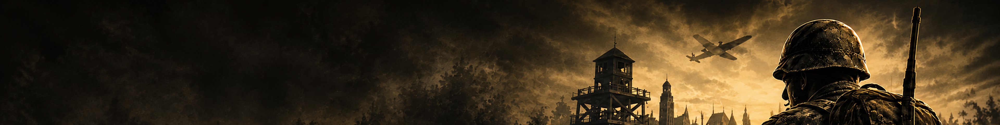

# HD Radar — édition originale

> Le [trainer HD Radar](https://github.com/anissfhd/hd-radar-trainer) porté de la version Ultimate Mod 5.0 de Hidden & Dangerous Deluxe vers le **`hde.exe` d'origine de 2003, sans mod**. Chaque adresse, offset de structure, rang de vtable et numéro de message du moteur a été remesuré sur le binaire d'origine ; le trainer refuse de s'attacher à toute autre version.

[](https://isocpp.org/)
[](#compiler-depuis-les-sources)
[](#comment-le-portage-a-été-fait)
[](https://github.com/ocornut/imgui)
[](https://cmake.org/)
[](LICENSE)

🇬🇧 [Read this document in English](README.md)

<p align="center">
  
</p>

---

## Quel dépôt choisir ?

| Votre jeu | Dépôt |
|---|---|
| Hidden & Dangerous Deluxe **avec Ultimate Mod 5.0** | [hd-radar-trainer](https://github.com/anissfhd/hd-radar-trainer) |
| Hidden & Dangerous Deluxe **1.50 d'origine** (`hde.exe` de 1 073 197 octets, horodatage PE `0x3F7D64C4`) | celui-ci |

Les deux exécutables sont des compilations différentes : 35 des 36 adresses de code et de données utilisées par le trainer ont bougé, toutes les variables globales passent de `0x10Axxx` à `0x0FAxxx`, et le mod a inséré 0x14 octets dans la classe des soldats. Un trainer construit pour l'un écrit au mauvais endroit dans l'autre : cette édition lit donc l'en-tête PE du `hde.exe` en cours et s'arrête avec `ERROR_REVISION_MISMATCH` si ce n'est pas l'original.

---

## Téléchargement

Le trainer prêt à lancer est publié dans une **[Release GitHub](https://github.com/anissfhd/hd-radar-trainer-original/releases/latest)** — un seul exécutable, sans installateur : `HDFinalAdvancedV165_ORIGINAL.exe`. Son empreinte SHA-256 est donnée dans les notes de la Release.

**Prérequis :** Hidden & Dangerous Deluxe 1.50, `hde.exe` d'origine ; Windows 10/11 ; le [Microsoft Visual C++ Redistributable x86](https://aka.ms/vs/17/release/vc_redist.x86.exe). Windows Defender et SmartScreen signalent souvent les trainers, car ils lisent et écrivent la mémoire d'un autre processus ; le code source complet est ici pour vérifier ce que fait l'exécutable.

---

## État des fonctions sur le jeu d'origine

| Fonction | État |
|---|---|
| Radar, ESP ennemis et alliés | ✅ vérifié en jeu |
| Protection réseau (quatre gardes), filtre de dégâts | ✅ vérifié en jeu |
| Vitesse du jeu (**9** / **8**) | ✅ vérifié en jeu |
| Création de soldats (`CreateActor`), fenêtre des soldats, menus | ✅ vérifié en jeu |
| Aimbot, avec verrou de cible stable et changement par geste de souris | ✅ porté, hooks contrôlés hors jeu |
| Munitions illimitées et tir rapide | ✅ porté, le contexte de l'arme est résolu en jeu |
| Noclip, ranimer, vitesse du joueur et du véhicule, braquage, véhicule indestructible, téléportation | ✅ porté, hooks contrôlés hors jeu |
| Fullhands (**M** / **F5**) | ✅ porté — le moteur d'origine ignore la ligne du catalogue et donne toujours le kit standard |
| Bullet Track, balles à travers les murs, Bullet Track V2 | ❌ non porté — dans l'original, le `Finish` du tir est intégré à `C_gun_shoot::Tick`, avec d'autres champs |
| Précision stable (sans recul ni dispersion) | ❌ impossible — la table des objets de l'original n'a pas de colonnes de dispersion ni de recul |
| Utilitaires d'autorité IA en LAN | ❌ non porté |

Les fonctions non portées vérifient les octets du jeu avant d'écrire ; sur l'original la vérification échoue et elles restent inactives, avec un message dans le panneau et le journal.

`tools/verify_hooks.py` relit les 28 points de hook dans le `hde.exe` d'origine et les compare aux octets attendus par le trainer : **28/28 conformes**.

---

## Touches

| Touche | Action |
|---|---|
| **F3** | Sortir du véhicule, même en vol ou coincé |
| **F4** | Santé max : un appui étend et remplit, un second annule |
| **F5** / **M** | Fullhands |
| **F6** | Liste des véhicules de la mission |
| **F8 / F9** | Vitesse du joueur : augmenter / réduire |
| **F10** | Ranimer le soldat contrôlé |
| **F12** | Restaurer le modèle du soldat |
| **G** | À pied : fenêtre des soldats · au volant : réparer le véhicule |
| **K** | Carte native : téléportation, ou ordre à l'escouade choisie |
| **V** | Noclip — **Z S A E** pour se déplacer, **H B** pour monter / descendre |
| **N / B** | Vitesse du véhicule : augmenter / réduire |
| **I / U** | Braquage plus vif / retour à l'origine |
| **9 / 8** | Vitesse du jeu : accélérer / ralentir (1× à 100×) |

**Aimbot :** une fois verrouillée, la cible le reste tant qu'elle est vivante, à portée et devant la caméra, même cachée jusqu'à 1,2 s. Un mouvement de souris horizontal rapide (500 comptes bruts en 200 ms) fait passer à l'ennemi le plus proche de ce côté.

---

## Comment le portage a été fait

Le portage part d'une copie du trainer V165 et se fait en trois étapes rejouables (`tools/apply_port.py`, `apply_port_etape2.py`, `apply_port_etape3.py`). Chaque correspondance vient du désassemblage des deux binaires avec capstone :

- **Fonctions** : appariées entre les deux `hde.exe` par code normalisé, graphe d'appels et vtables (`bindiff_lite.py`), puis chaque adresse de code du trainer est traduite (`resolve_targets.py`).
- **Globales et champs** : localisés par vote sur toutes les instructions qui les utilisent, classe par classe (`map_operands.py`, `actor_fields.py`). Les champs des soldats de `0x178` à `0x2E4` sont 0x14 plus bas ; ceux des véhicules après `0x25C`, 8 plus bas.
- **Vtables** : 68 entrées dans l'original contre 76 ; `IsEnemy`, `Hit`, `Explode`, `Die` et `GetTable` ont changé de rang (`vtable_slots.py`).
- **Messages du moteur** : tous les `cbProc` des acteurs prennent trois arguments dans l'original (`ret 0Ch`) au lieu de quatre, et les numéros au-delà de 33 sont décalés de −1.

Corrections trouvées pendant l'audit sur l'original :

- `GetTable` est au rang `0xAC`, hors de la plage balayée par la version du mod.
- La table des objets de l'original s'arrête à la propriété `0x1D` ; le trainer exigeait les colonnes de recul avant toute action sur l'arme, ce qui désactivait munitions illimitées et tir rapide.
- La boucle du catalogue de Fullhands allait jusqu'à la ligne `0x3FF` ; le catalogue de l'original est bien plus court et le jeu plantait après sa dernière ligne. La boucle s'arrête maintenant au nombre réel de lignes.
- La boucle du trainer tournait sans pause quand son propre appareil Direct3D était perdu sous un jeu en plein écran.

Le détail complet — chaque adresse, offset et rang, côte à côte — est dans [`docs/PORTAGE.md`](docs/PORTAGE.md), et les résultats bruts de l'analyse dans [`docs/analyse/`](docs/analyse/).

---

## Compiler depuis les sources

Il faut Visual Studio 2022 ou 2026 avec la charge de travail C++, et CMake 3.21+. La cible **doit être Win32/x86**.

```powershell
.\build.ps1                       # Release, Visual Studio 2026
.\build.ps1 -Preset vs2022-x86    # Visual Studio 2022
```

Dear ImGui est téléchargé à la configuration, figé sur `v1.91.9b`. Le trainer est produit dans `build/vs2026-x86/Release/HDFinalAdvancedV165_ORIGINAL.exe`.

Les outils d'analyse de [`tools/`](tools/) demandent Python 3 avec `capstone` et `pefile`, ainsi que les deux `hde.exe`, qui ne sont pas fournis.

## Utilisation

1. Lancer le jeu. Le `hde.exe` d'origine écrit dans `HKLM` et doit être lancé **en administrateur**.
2. Lancer `HDFinalAdvancedV165_ORIGINAL.exe` **en administrateur** lui aussi, sinon il ne peut pas ouvrir le processus du jeu.
3. Un journal de diagnostic `hdradar_diag.log` est écrit à côté du trainer.

Les réglages sont rangés sous `HKCU\Software\HDPhase1_Original`, à part de ceux de l'édition du mod (`HKCU\Software\HDPhase1`).

Pour un rendu plus fluide, l'adaptateur d3d8to9 (`d3d8.dll`, de crosire) peut être placé dans le dossier `bin` du jeu : il fait passer le Direct3D 8 du jeu par Direct3D 9, comme le fait Ultimate Mod.

---

## Licence

[MIT](LICENSE) pour le code de ce dépôt. *Hidden & Dangerous* est une marque de ses propriétaires respectifs ; ce projet est non officiel et sans lien avec eux. Les binaires du jeu ne sont pas fournis. Dear ImGui est sous licence MIT, par Omar Cornut.
