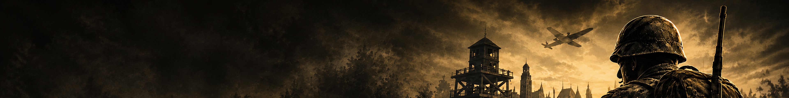

# HD Radar — Original edition

> The [HD Radar trainer](https://github.com/anissfhd/hd-radar-trainer) ported from the Ultimate Mod 5.0 build of Hidden & Dangerous Deluxe to the **original, unmodded 2003 `hde.exe`**. Every address, structure offset, virtual-table slot and engine message number was re-measured against the original binary; the trainer refuses to attach to any other build.

[](https://isocpp.org/)
[](#building-from-source)
[](#how-the-port-was-done)
[](https://github.com/ocornut/imgui)
[](https://cmake.org/)
[](LICENSE)

🇫🇷 [Lire ce document en français](README.fr.md)

<p align="center">
  
</p>

---

## Which repository do I need?

| Your game | Repository |
|---|---|
| Hidden & Dangerous Deluxe **with Ultimate Mod 5.0** | [hd-radar-trainer](https://github.com/anissfhd/hd-radar-trainer) |
| Hidden & Dangerous Deluxe **1.50, original** (`hde.exe` of 1,073,197 bytes, PE timestamp `0x3F7D64C4`) | this one |

The two binaries are different compilations: 35 of the 36 code and data addresses the trainer uses moved, every global shifted from `0x10Axxx` to `0x0FAxxx`, and the mod inserted 0x14 bytes into the soldier class. A trainer built for one writes to the wrong place in the other, so this edition checks the PE header of the running `hde.exe` and stops with `ERROR_REVISION_MISMATCH` if it is not the original.

---

## Download

The ready-to-run trainer is published as a **[GitHub Release](https://github.com/anissfhd/hd-radar-trainer-original/releases/latest)** — one executable, no installer: `HDFinalAdvancedV165_ORIGINAL.exe`. Its SHA-256 checksum is listed in the release notes.

**Requirements:** Hidden & Dangerous Deluxe 1.50, original `hde.exe`; Windows 10/11; the [Microsoft Visual C++ Redistributable x86](https://aka.ms/vs/17/release/vc_redist.x86.exe). Windows Defender and SmartScreen commonly flag trainers because they read and write another process's memory; the full source is here to check what the executable does.

---

## Feature status on the original game

| Feature | Status |
|---|---|
| Radar, enemy and ally ESP | ✅ verified in game |
| Network protection (four guards), damage filter | ✅ verified in game |
| Game speed (**9** / **8**) | ✅ verified in game |
| Soldier creation (`CreateActor`), soldier window, menus | ✅ verified in game |
| Aimbot, with sticky target lock and raw-mouse switch gesture | ✅ ported, hooks verified offline |
| Unlimited ammo and rapid fire | ✅ ported, weapon context resolves in game |
| Noclip, revive, player and vehicle speed, steering, vehicle invulnerability, teleport | ✅ ported, hooks verified offline |
| Fullhands (**M** / **F5**) | ✅ ported — the original engine ignores the catalogue row and always gives the standard kit |
| Bullet track, bullets through walls, bullet track V2 | ❌ not ported — the original inlines the shot's `Finish` into `C_gun_shoot::Tick` with different fields |
| Stable precision (no recoil or spread) | ❌ impossible — the original item table has no spread or recoil columns |
| LAN AI-authority helpers | ❌ not ported |

Features that are not ported check the game's bytes before writing; on the original the check fails and they stay inactive, reported in the panel and the log.

`tools/verify_hooks.py` re-reads all 28 hook sites in the original `hde.exe` and compares them with the bytes the trainer expects: **28/28 match**.

---

## Hotkeys

| Key | Action |
|---|---|
| **F3** | Leave the vehicle, even mid-air or stuck |
| **F4** | Max health: one press extends and fills, a second press cancels |
| **F5** / **M** | Fullhands |
| **F6** | Mission vehicle list |
| **F8 / F9** | Player speed up / down |
| **F10** | Revive the controlled soldier |
| **F12** | Restore the soldier's model |
| **G** | On foot: soldier window · driving: repair the vehicle |
| **K** | Native map: teleport, or give an order to the selected squad |
| **V** | Noclip on/off — **Z S A E** move, **H B** up/down |
| **N / B** | Vehicle speed up / down |
| **I / U** | Steering sharper / back to original |
| **9 / 8** | Game speed up / down (1× to 100×) |

**Aimbot:** once a target is locked it stays locked while it is alive, in range and in front of the camera, even hidden for up to 1.2 s. A quick horizontal mouse flick (500 raw counts in 200 ms) switches to the nearest enemy on that side.

---

## How the port was done

The port started from a copy of trainer V165 and was carried out in three replayable steps (`tools/apply_port.py`, `apply_port_etape2.py`, `apply_port_etape3.py`). Each mapping was established by disassembling both binaries with capstone, not by guessing:

- **Functions** were paired between the two `hde.exe` builds by normalized code, call graph and virtual tables (`bindiff_lite.py`), then every code address in the trainer was translated (`resolve_targets.py`).
- **Globals and fields** were located by voting over every instruction operand that touches them, per class (`map_operands.py`, `actor_fields.py`). Soldier fields from `0x178` to `0x2E4` are 0x14 lower; vehicle fields past `0x25C` are 8 lower.
- **Virtual tables** have 68 entries in the original instead of 76; `IsEnemy`, `Hit`, `Explode`, `Die` and `GetTable` all moved (`vtable_slots.py`).
- **Engine messages**: every actor `cbProc` takes three arguments in the original (`ret 0Ch`) instead of four, and message numbers above 33 are one lower.

Fixes found while auditing the port on the original:

- `GetTable` sits at slot `0xAC`, outside the range the mod build scanned.
- The original item table stops at property `0x1D`; the trainer required the recoil columns before touching any weapon, which disabled unlimited ammo and rapid fire.
- The Fullhands catalogue loop ran to row `0x3FF`; the original catalogue is much shorter and the game crashed past its last row. The loop is now bounded by the table's real row count.
- The trainer's loop spun without pause when its own Direct3D device was lost under a fullscreen game.

The full record — every address, offset and slot, side by side — is in [`docs/PORTAGE.md`](docs/PORTAGE.md) (French), with the raw analysis output in [`docs/analyse/`](docs/analyse/).

---

## Building from source

Requires Visual Studio 2022 or 2026 with the C++ workload, and CMake 3.21+. The target **must be Win32/x86**.

```powershell
.\build.ps1                       # Release, Visual Studio 2026
.\build.ps1 -Preset vs2022-x86    # Visual Studio 2022
```

Dear ImGui is fetched at configure time and pinned to `v1.91.9b`. The trainer lands in `build/vs2026-x86/Release/HDFinalAdvancedV165_ORIGINAL.exe`.

The analysis tools in [`tools/`](tools/) need Python 3 with `capstone` and `pefile`, and the two `hde.exe` files, which are not included.

## Usage

1. Start the game. The original `hde.exe` writes to `HKLM` and must run **as administrator**.
2. Run `HDFinalAdvancedV165_ORIGINAL.exe` **as administrator** too, or it cannot open the game process.
3. A diagnostic log is written next to the trainer as `hdradar_diag.log`.

Settings are stored under `HKCU\Software\HDPhase1_Original`, apart from the mod edition's `HKCU\Software\HDPhase1`.

For smoother rendering, the d3d8to9 wrapper (`d3d8.dll`, by crosire) can be placed in the game's `bin` folder: it runs the game's Direct3D 8 through Direct3D 9, as Ultimate Mod does.

---

## License

[MIT](LICENSE) for the code in this repository. *Hidden & Dangerous* is a trademark of its respective owners; this project is unofficial and not affiliated with them. The game's binaries are not included. Dear ImGui is MIT-licensed by Omar Cornut.
